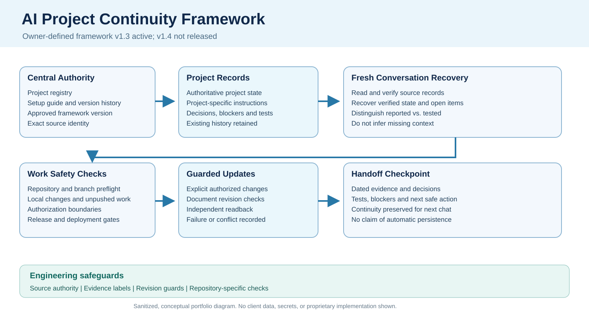

# AI Project & Workspace Continuity Framework

**Focus:** AI-assisted engineering governance, continuity, verification, and project organization  
**Current documented framework:** v1.4 active (reduced identity-assurance scope; rollout closed November 26, 2026)  
**Public artifact:** Conceptual engineering case study, not the authoritative internal framework

## Architecture diagram

*Conceptual view of the owner-defined framework. Recovery and changes depend on verified source access; this is not automatic platform memory.*

## The problem

Long-running software and automation projects often span many ChatGPT conversations, multiple code repositories, files, and development environments. Without explicit continuity practices, a new conversation can lose decisions, confuse project identity, repeat tests unnecessarily, or treat an unverified claim as established fact.

## Design approach

Developed an owner-defined project continuity standard based on:

- A central registry identifying each project's authoritative records
- Owner-confirmed platform project identifiers, exact namespaced matching, and fail-closed handling of missing or conflicting identities
- Separate project state and project instructions, preserving their different purposes
- Explicit version history and release authority for the standard itself
- Recovery procedures for fresh conversations that re-read authoritative project records
- Dated checkpoints covering decisions, tests, unresolved blockers, and next safe actions
- Evidence labels distinguishing verified outcomes, user-reported results, proposed work, and untested assumptions
- Guarded document updates and readback checks to reduce accidental overwrites
- Repository-specific safety checks before modifying code in a development workspace

## Example workflow

1. Identify the exact project and authoritative source records.
2. Verify the currently active framework version and project scope.
3. Recover the latest decisions, tests, current status, and open blockers.
4. Check relevant repository branches, pending changes, and integration boundaries.
5. Complete authorized work using an incremental verify-and-record process.
6. Append a dated checkpoint, verify persistence, and leave a concrete next step.

## Release and rollout outcome

The v1.4 rollout was completed across nine ChatGPT project workspaces representing eight logical projects. Two workspaces intentionally share one authoritative continuity record pair.

- Verified nine unique active project identity mappings, eight original project folders, and sixteen native project continuity documents.
- Verified five central framework documents and five historical Markdown archives, preserving original identities and access boundaries.
- Recorded nine successful fresh-conversation acceptance reports, totaling 98 of 98 reported checks, with independent corroboration of authoritative storage and mappings. These are recorded owner-reported test outcomes, not 98 independently rerun tests.
- Completed the formal rollout closeout with a revision-guarded documentation update and independent readback.

This milestone validates the defined continuity process, not production readiness of the underlying applications.

## Important limits

This is a **personal AI-assisted project-management and engineering process**, not an official ChatGPT/OpenAI standard or a guarantee of persistent AI memory. It does not imply that ChatGPT can automatically access every workspace, local development machine, or repository. New-chat acceptance and repository tests must be verified individually.

The framework distinguishes its *active* version from proposed revisions. Automatic current-session project identification, automatic folder-name synchronization, and unqualified cross-agent writing remain outside the released scope. Owner-confirmed identity is not automatic platform authentication. Application acceptance, runtime checks, and future multi-agent qualification remain separate.

## Skills demonstrated

AI workflow design, engineering process design, project governance, documentation architecture, change control, release discipline, and verification.

*Internal registry identifiers, source documents, credentials, and project-specific confidential content are excluded from this public summary.*
