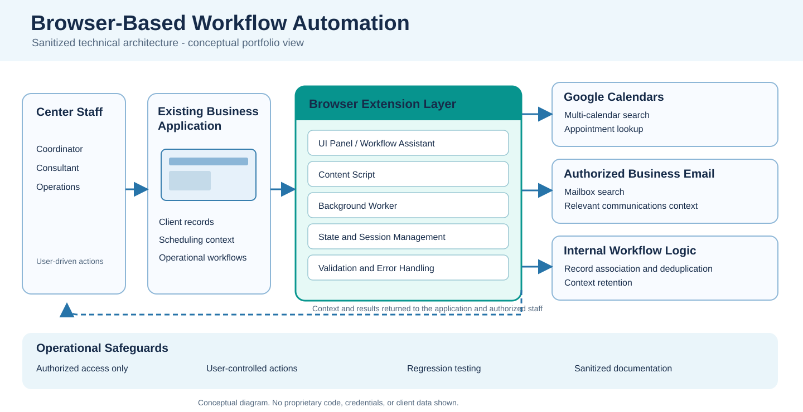

# Browser-Based Workflow Automation

**Focus:** Browser extensions, systems integration, business workflow automation  
**Status:** Developed and actively refined

## Architecture diagram

The diagram is an illustrative, sanitized view of the extension's architecture and data flow. It intentionally omits implementation details, secrets, and identifiable client information.

## Business problem

Staff working in a line-of-business application need related appointment and communication context from several systems. Switching among tools creates repeated searches, manual work, and opportunities for lost context.

## Solution approach

Developed browser extension functionality to assist authorized client workflows in an existing business application, including:

- Searching multiple Google Calendars for relevant appointments
- Searching authorized business mailboxes for client-related emails
- Reducing repetitive data entry and navigation
- Preserving appropriate client and appointment context across application screens

## Engineering considerations

- Accurate client and contact association
- Deduplication and avoidance of stale calendar results
- Mailbox authorization, information privacy, and least privilege
- UI state persistence, error handling, and recoverability
- Regression testing of workflows and client context changes
- Human oversight for actions affecting business records

## Scope and limitations

This is a sanitized architectural case study, not a public release of the extension. Work has been iteratively tested and refined; this document does not claim that all features are production-certified or in franchise-wide use. No client records, credentials, internal endpoints, or proprietary source code are included.

## Skills illustrated

Software development, browser extensions, systems integration, business process automation, testing, and AI-assisted development.
